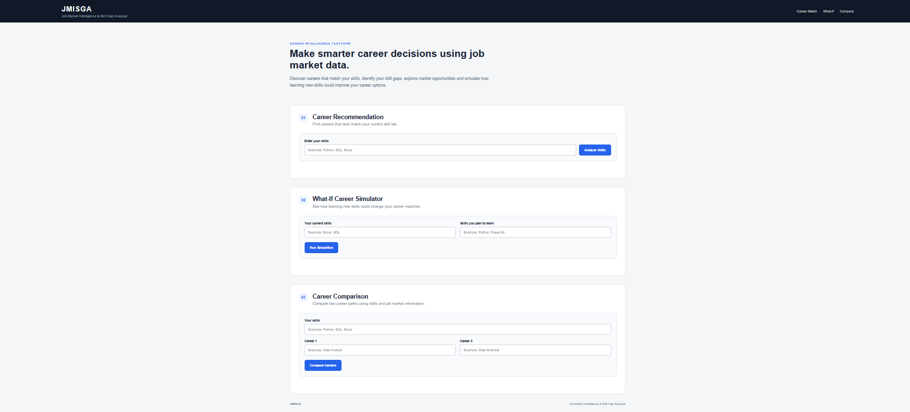
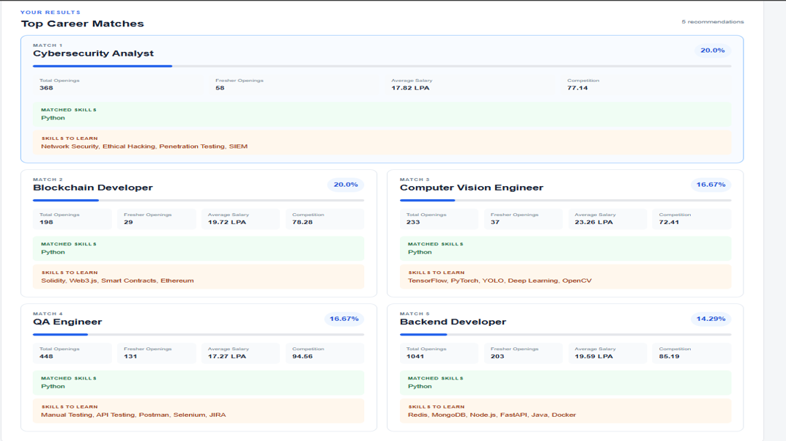
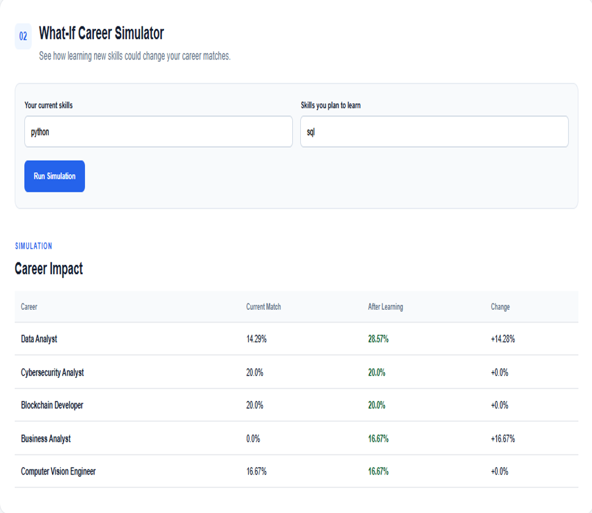
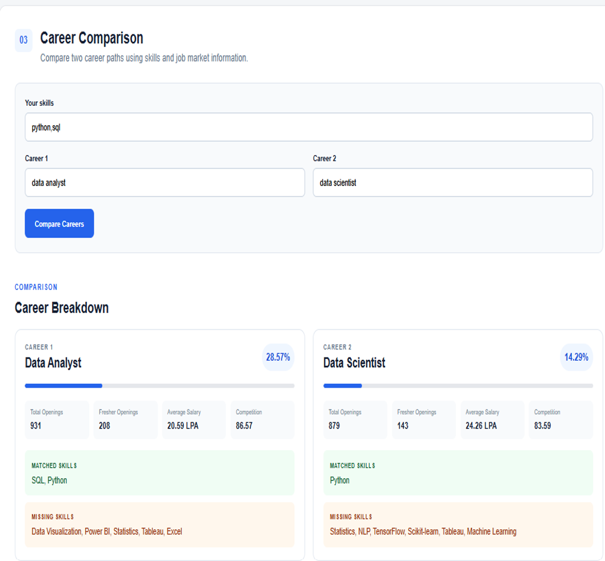

# JMISGA — Job Market Intelligence & Skill Gap Analyzer

JMISGA is a **data-driven career decision-support platform** designed to help students and freshers explore career opportunities in the Indian IT job market.

The project analyzes a **5,000-record India Job Market 2024–2026 dataset obtained from Kaggle** to identify trends in job roles, required skills, salaries, experience levels, job openings, fresher opportunities, and applicant competition.

JMISGA goes beyond job market analysis by providing **career recommendations, skill-gap analysis, career comparison, and a What-If Career Simulator** based on a user's existing and planned skills.

---

## 📸 JMISGA Dashboard



---

## 🚀 Key Features

### 🎯 Career Recommendation
Users enter their existing skills and JMISGA identifies career roles that best match their current skill set.

The recommendation includes:
- Skill Match Percentage
- Total Job Openings
- Fresher Openings
- Average Salary
- Competition Ratio
- Matched Skills
- Skills to Learn



### 🔍 Skill Gap Analysis
For each recommended career, JMISGA compares the user's skills with the core skills required for that role and identifies:

- **Matched Skills** — skills the user already possesses
- **Missing Skills** — skills the user may need to develop

This makes the recommendation transparent and easy to understand.

### 🔮 What-If Career Simulator
The What-If Simulator allows users to enter skills they are planning to learn.

JMISGA recalculates career matches and compares:

**Current Match → Match After Learning**

This helps users explore how learning new skills could affect their suitability for different career paths.



### ⚖️ Career Comparison
Users can compare two career paths side-by-side using:

- Skill Match Percentage
- Total Openings
- Fresher Openings
- Average Salary
- Competition
- Matched Skills
- Missing Skills



---

## 📊 Job Market Analysis

The dataset was analyzed to understand different aspects of the Indian job market, including:

- Most in-demand job roles
- Most demanded skills
- Job openings by experience level
- Fresher job opportunities
- Salary trends by experience level
- Salary trends by company type
- Work mode distribution
- Applicant competition across career roles
- Job posting trends over time
- Role-specific skill requirements

Some key observations from the dataset include:

- **Software Engineer** recorded the highest total openings with **1,253 openings**.
- **Python** was the most frequently occurring required skill, appearing in **1,579 job records**.
- The dataset contained **3,980 fresher-level openings**.
- Average salary increased considerably with experience level, from approximately **5.50 LPA for freshers** to **52.95 LPA for lead-level roles**.

---

## 🧠 How JMISGA Works

JMISGA currently uses a **transparent rule-based approach** rather than a machine-learning model.

### 1. Data Preparation
The job market dataset is loaded, inspected, cleaned, and analyzed using Pandas.

### 2. Core Skill Identification
For each career role, skills are extracted from the `Skills_Required` field.

The most frequently occurring skills for each career are identified, and up to the **top 7 skills** are treated as the role's core skills.

### 3. Skill Matching
The user's skills are compared with the core skills of each career.

The system identifies:
- Matched skills
- Missing skills
- Skill match percentage

### 4. Career Recommendation
Career roles are ranked primarily according to the user's skill match.

The recommendation is supported by job-market information such as salary, openings, fresher opportunities, and competition.

### 5. What-If Simulation
The user's current skills are combined with skills they plan to learn, and career matches are recalculated.

### 6. Career Comparison
Two careers can be compared using both skill compatibility and job-market information.

---

## 🗂️ Dataset

**Dataset:** India Job Market 2024–2026  
**Source:** Kaggle  
**Records:** 5,000  
**Format:** CSV

The dataset contains information including:

`Job Title` • `Company` • `Company Type` • `Industry` • `City` • `Experience Level` • `Job Type` • `Work Mode` • `Salary (LPA)` • `Skills Required` • `Education Required` • `Openings` • `Applicants` • `Date Posted`

> The dataset was obtained from Kaggle and is used for educational and analytical purposes in this project.

---

## 💻 Tech Stack

- **Python** — Core programming language
- **Pandas** — Data cleaning and analysis
- **Matplotlib** — Data visualization
- **Flask** — Web application backend
- **HTML & CSS** — User interface

---

## 📁 Project Structure

```text
JMISGA/
│
├── app.py
├── india_job_market_2024-26.csv
├── README.md
│
├── templates/
│   └── index.html
│
├── static/
│   └── style.css
│
├── screenshots/
│   ├── jmisga-dashboard.png
│   ├── career-recommendation.png
│   ├── what-if-simulator.png
│   └── career-comparison.png
│
└── notebooks/
    ├── JMISGA_Analysis.ipynb
    ├── JMISGA_Visualizations.ipynb
    └── JMISGA_Skill_Gap_Analyzer.ipynb
```

---

## ⚙️ Running the Project

### 1. Clone the repository

```bash
git clone https://github.com/sanabhatia18/JMISGA-Job-Market-Intelligence-Skill-Gap-Analyzer.git
```

### 2. Open the project directory

```bash
cd JMISGA-Job-Market-Intelligence-Skill-Gap-Analyzer
```

### 3. Install the required libraries

```bash
pip install pandas matplotlib flask
```

### 4. Run the Flask application

```bash
python app.py
```

### 5. Open in your browser

```text
http://127.0.0.1:5000
```

---

## 🔮 Future Scope

Future versions of JMISGA can be extended with:

- Real-time job data from multiple job portals
- Resume-based automatic skill extraction
- Personalized learning-resource recommendations
- User profiles and skill-progress tracking
- Larger datasets covering more industries and locations
- Advanced recommendation techniques and machine learning

---

## 👩‍💻 Author

**Sana Bhatia**

B.Tech Computer Science & Engineering — Artificial Intelligence & Machine Learning

GitHub: **@sanabhatia18**

